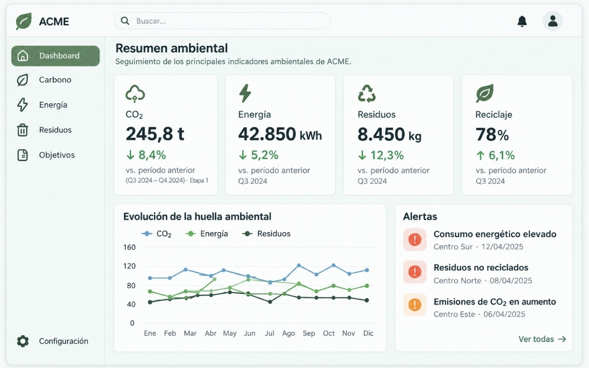
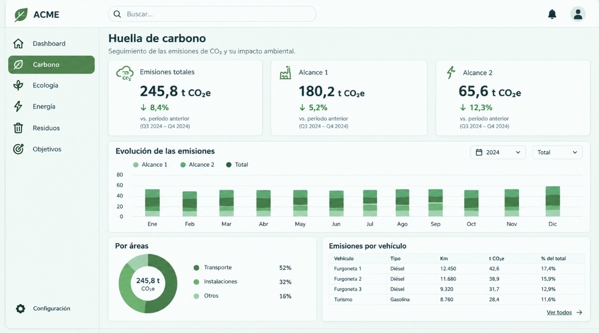
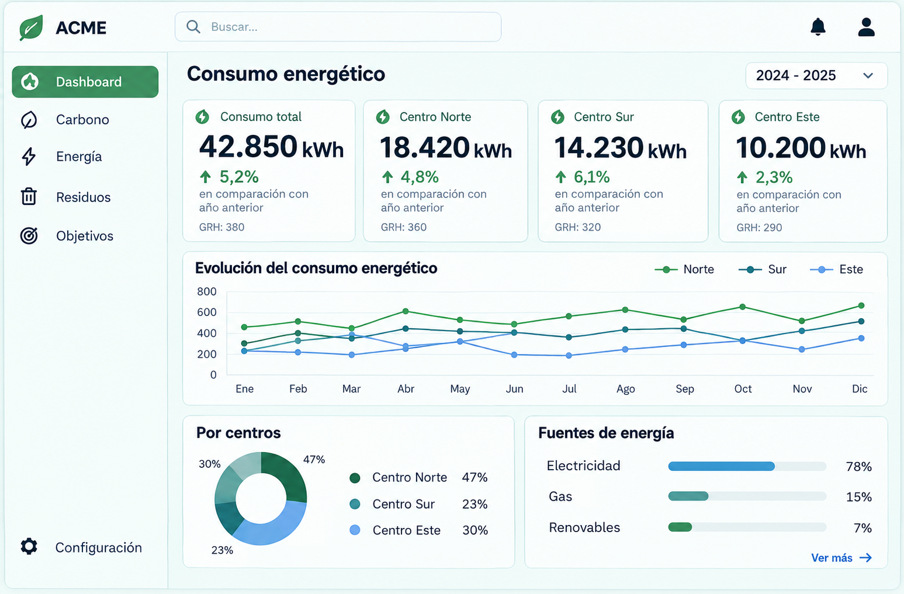
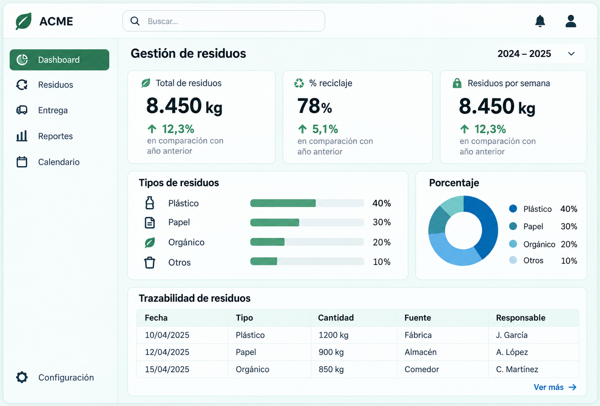
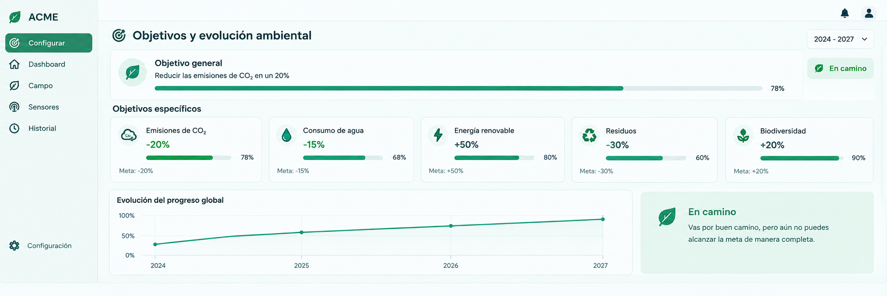

## Mockup de la aplicación web

Primero hice los bocetos a mano para tener una idea de cómo quería organizar las pantallas. Después, los pasé a Figma para darles un aspecto más visual y ver mejor cómo quedaría la aplicación.

### Dashboard ambiental

### Huella de carbono

### Consumo energético

### Gestión de residuos

### Objetivos y evolución ambiental

### Dashboard ambiental

### Huella de carbono

### Consumo energético

### Gestión de residuos

### Objetivos y evolución ambiental

